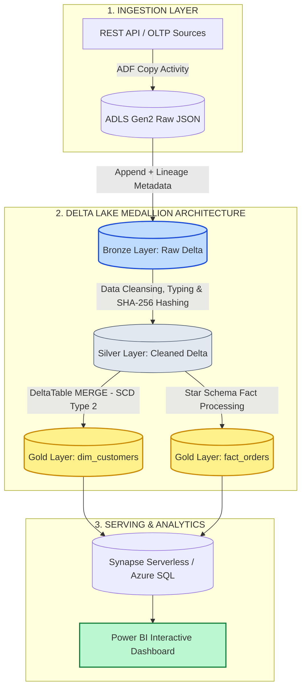

# Enterprise Azure Lakehouse Platform with Delta Lake Medallion Architecture & SCD Type 2

[](https://www.python.org/downloads/)
[](https://spark.apache.org/)
[](https://delta.io/)
[](https://azure.microsoft.com/)
[](https://powerbi.microsoft.com/)
[](https://github.com/)

An end-to-end cloud and big data engineering project demonstrating an enterprise-grade **Lakehouse Platform** built on the **Medallion Architecture (Bronze ➔ Silver ➔ Gold)**. 

The pipeline ingests raw transactional event data, performs schema validation and deduplication, and applies **Slowly Changing Dimensions (SCD Type 2)** via **Delta Lake `MERGE`** operations to maintain point-in-time historical audits of dimensional changes for executive **Power BI** reporting.

---

## Architecture Diagram



---

## Medallion Architecture Breakdown

| Layer | Storage Format | Operations Performed | Output Entity |
|---|---|---|---|
| **Raw / Landing** | JSON Lines | ADF ingestion from upstream REST APIs / message queues | `data/raw/*.json` |
| **Bronze** | Delta Lake | Append-only landing zone preserving raw fidelity; injects `_ingested_at`, `_source_batch`, and `_source_file` | `/lakehouse/bronze/` |
| **Silver** | Delta Lake | Cleansing, string trimming, lowercase email normalization, deduplication with window functions, type casting, and SHA-256 hash generation of dimensional attributes | `/lakehouse/silver/` |
| **Gold** | Delta Lake | Star Schema modeling; implements **SCD Type 2** for `dim_customers` via atomic `MERGE`; partitions `fact_orders` by `order_year` and `order_month` | `/lakehouse/gold/` |
| **Serving** | Parquet / CSV | Synapse Serverless SQL external tables / DirectQuery integration for Power BI executive dashboards | `/powerbi_export/` |

---

## Slowly Changing Dimensions (SCD Type 2) In Action

SCD Type 2 preserves the complete historical trajectory of dimensional attributes by expiring outdated records and inserting new active rows.

### Example Walkthrough (Customer `CUST_101`):
1. **Batch 1 (Initial Load):** Customer lives in *Bengaluru* with *Bronze* tier.
   - Inserted with `start_date = 2026-01-10`, `end_date = NULL`, `is_current = True`.
2. **Batch 2 (Incremental Update):** Customer relocates to *Hyderabad*.
   - The Delta Lake `MERGE` statement detects a change in the SHA-256 hash key.
   - Version 1 is updated: `end_date = 2026-01-20`, `is_current = False`.
   - Version 2 is inserted: `city = Hyderabad`, `start_date = 2026-01-20`, `end_date = NULL`, `is_current = True`.

```
┌───────────┬──────────────┬───────────┬──────────────┬────────────┬────────────┬────────────┐
│ Cust_Key  │ Customer_ID  │ City      │ Loyalty_Tier │ Start_Date │ End_Date   │ Is_Current │
├───────────┼──────────────┼───────────┼──────────────┼────────────┼────────────┼────────────┤
│ 8a4f91... │ CUST_101     │ Bengaluru │ Bronze       │ 2026-01-10 │ 2026-01-20 │ False      │
│ c3d10e... │ CUST_101     │ Hyderabad │ Bronze       │ 2026-01-20 │ NULL       │ True       │
└───────────┴──────────────┴───────────┴──────────────┴────────────┴────────────┴────────────┘
```

---

## Repository Structure

```text
azure-lakehouse-medallion-scd2/
├── .github/
│   └── workflows/
│       └── ci.yml                     # GitHub Actions CI for linting & tests
├── adf/
│   └── pipeline_azure_data_factory.json # Production ADF Pipeline Export template
├── data/
│   ├── raw/                           # Raw synthetic JSON landing zone
│   └── powerbi_export/                # Exported CSVs ready for Power BI
├── powerbi/
│   └── powerbi_data_model_guide.md    # Star Schema relationships & DAX measures
├── scripts/
│   └── generate_sample_data.py        # Generates Batch 1 & Batch 2 test datasets
├── src/
│   ├── config.py                      # Path configuration & Delta Lake variables
│   ├── spark_utils.py                 # SparkSession builder with Delta Lake catalog
│   ├── bronze_ingestion.py            # Bronze Delta layer pipeline
│   ├── silver_cleaning.py             # Silver layer deduplication & SHA-256 hashing
│   ├── gold_dimensional_scd2.py      # Gold layer DeltaTable MERGE (SCD Type 2)
│   ├── export_powerbi.py              # Gold layer exporter for Power BI Desktop
│   └── run_pipeline.py                # Single-command end-to-end pipeline runner
├── tests/
│   └── test_pipeline.py               # PyTest unit tests
├── requirements.txt                   # Project dependencies
├── .gitignore                         # Git exclusion rules
└── README.md                          # Project documentation
```

---

## Quickstart: Run Locally in 3 Steps

### Prerequisites
- Python 3.10 or higher
- Java 8 or 11 (required for PySpark local execution)

### 1. Clone & Install
```bash
git clone https://github.com/YOUR_USERNAME/azure-lakehouse-medallion-scd2.git
cd azure-lakehouse-medallion-scd2

python -m venv venv
# On Windows:
.\venv\Scripts\activate
# On Linux/macOS:
source venv/bin/activate

pip install -r requirements.txt
```

### 2. Execute the Entire Medallion Pipeline
Run the master orchestrator to generate test data, run Batch 1 baseline, run Batch 2 incremental SCD Type 2 updates, and export tables for Power BI:

```bash
python -m src.run_pipeline
```

### 3. Run Unit Tests
```bash
pytest tests/ -v
```

---

## Power BI Integration

1. Launch **Power BI Desktop**.
2. Click **Get Data** ➔ **Text/CSV**.
3. Load `data/powerbi_export/dim_customers.csv` and `data/powerbi_export/fact_orders.csv`.
4. Establish a 1-to-many relationship on `customer_surrogate_key`.
5. Key DAX metrics implemented:
   - **Total Revenue:** `SUM(fact_orders[total_amount])`
   - **Active Customers:** `CALCULATE(DISTINCTCOUNT(dim_customers[customer_id]), dim_customers[is_current] = TRUE())`
   - **Average Order Value (AOV):** `DIVIDE([Total Revenue], DISTINCTCOUNT(fact_orders[order_id]), 0)`

---

## Key Interview Talking Points (How to Defend This Project)

### Q: "Why Delta Lake instead of writing Parquet directly to ADLS Gen2?"
> **Answer:** *"Parquet is an immutable columnar file format, but it does not support ACID transactions or in-place row updates. If an ETL job fails midway through writing Parquet, you end up with corrupted, partial files. Delta Lake wraps Parquet with an atomic transaction log (`_delta_log`), enabling point-in-time time travel, schema enforcement, and native `MERGE` operations required to implement SCD Type 2."*

### Q: "How does your pipeline detect changes without scanning every field?"
> **Answer:** *"In the Silver layer, we compute a deterministic SHA-256 hash across all tracked dimensional attributes (`address`, `city`, `state`, `loyalty_tier`). When performing the Delta `MERGE` against the Gold layer, we compare `target.record_hash != source.record_hash`. This reduces comparison overhead from N attribute checks to a single string comparison."*

### Q: "How did you orchestrate this in Azure Data Factory?"
> **Answer:** *"The ADF pipeline (`adf/pipeline_azure_data_factory.json`) uses a Copy Activity to pull upstream REST payloads into the ADLS Gen2 raw container. On success, it triggers sequential Databricks Notebook Activities passing the batch timestamp parameter into the Bronze, Silver, and Gold transformation scripts with automated retries and failure alerts."*

---

## License
MIT License. Free to use, adapt, and showcase in personal portfolios.
